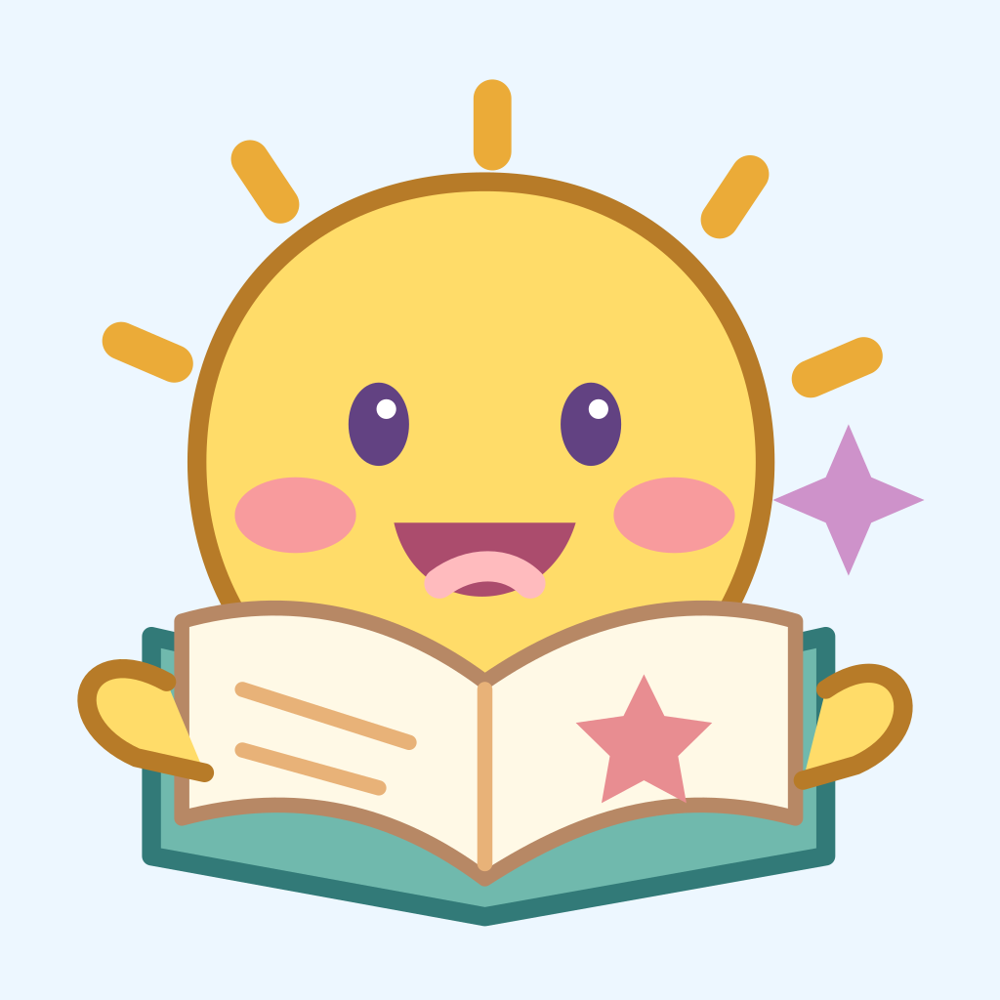
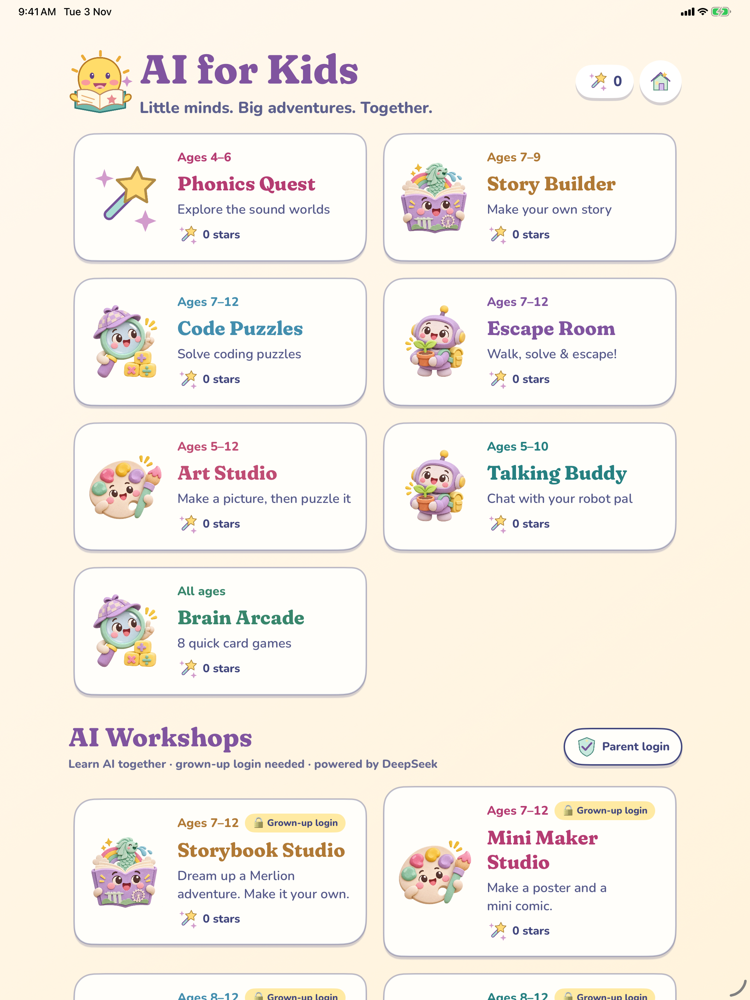
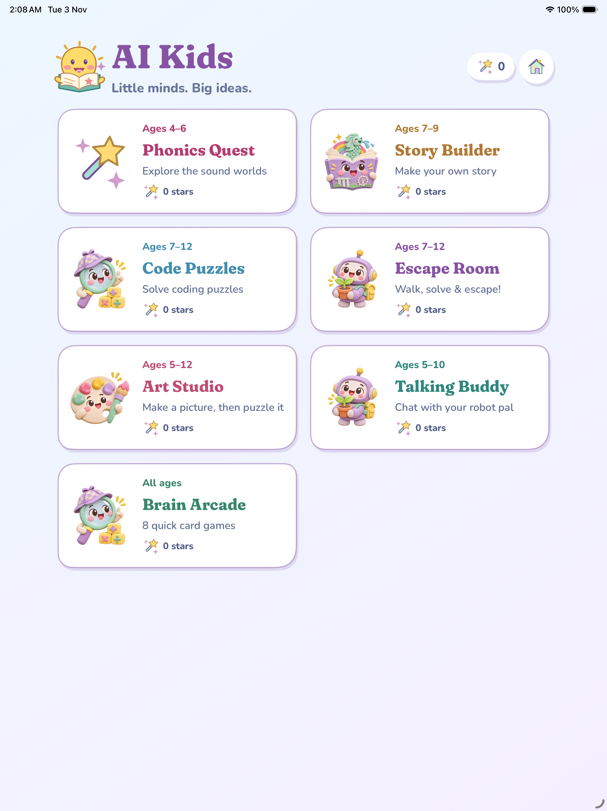
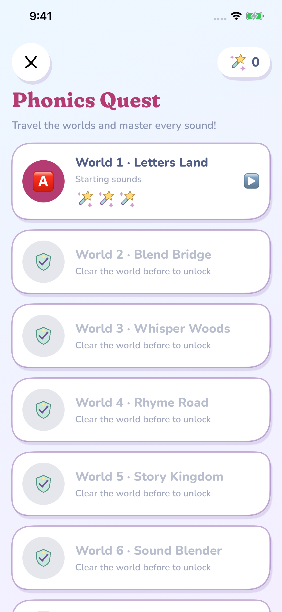
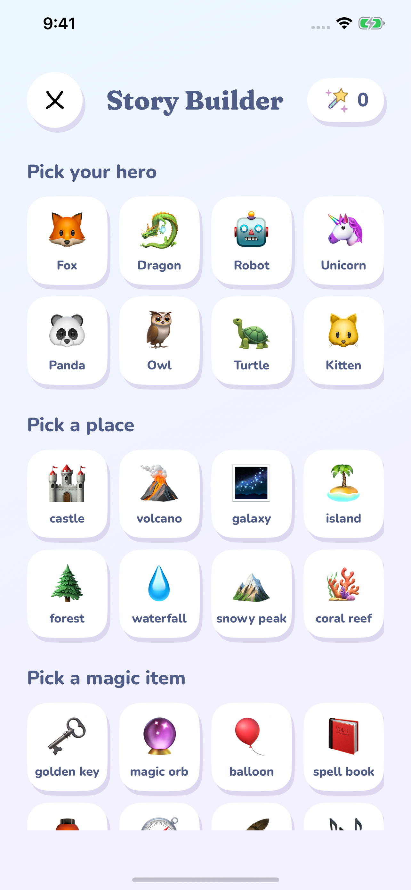
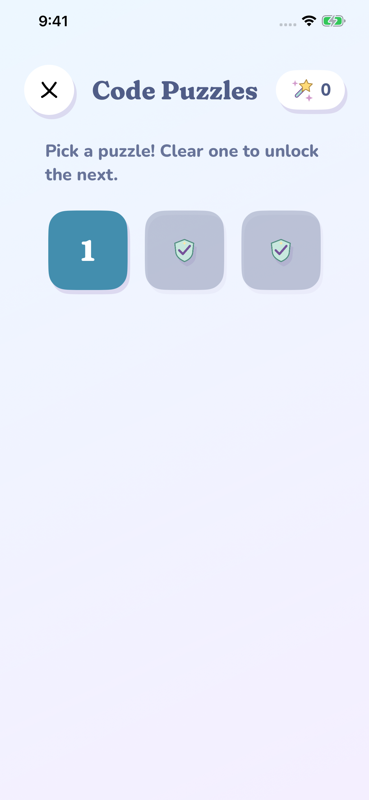

<div align="center">



# AI4Kids

### A native iPhone & iPad activity app where kids play, learn, and create — seven offline activities plus parent-unlocked AI Workshops powered by DeepSeek.

[](https://www.apple.com/ios/)
[](https://swift.org)
[](https://developer.apple.com/xcode/swiftui/)
[](https://apps.apple.com/app/ai4kids/id6780267161)
[](#-privacy)
[](#-ai-workshops-parent-unlocked)

**[⬇️ Download on the App Store](https://apps.apple.com/app/ai4kids/id6780267161)**

Inspired by the [AI Kids Academy](https://ai4kids.tertiarycourses.com.sg/) programme by Tertiary Infotech.

</div>



Version 1.6 adds four **AI Workshops** behind a grown-up login and restyles the app in
the website's warm cream, purple, teal and sunny-yellow palette (Fraunces / Nunito).
All seven play activities continue to work offline.

---

## ✨ Overview

**AI4Kids** is a bright, friendly **universal app (iPhone + iPad)** for young learners (ages 4–16), with layouts that adapt to each screen size. It bundles seven self-contained learning activities that run **entirely on-device** (no internet, no accounts, no ads and **no data collection**), plus four optional **AI Workshops** that a parent unlocks with a PIN and their own DeepSeek API key.

<div align="center">

</div>

## 🎮 The Seven Activities

| | Activity | Ages | What kids do |
|---|---|---|---|
| 🔤 | **Phonics Quest** | 4–6 | Seven sound worlds of phonics mini-games with on-device phoneme audio. |
| 📖 | **Story Builder** | 7–9 | Pick a hero, place, object and mood; the app weaves a twice-branching story. |
| 🧩 | **Code Puzzles** | 10–12 | Sequence arrows and Scratch-style repeat loops to walk a robot to the goal. |
| 🚪 | **Escape Room** | 8+ | Five walk-around puzzle rooms full of clues, keys and locked doors. |
| 🎨 | **Art Studio** | All | Compose an on-device picture, then solve it as a tap-to-place jigsaw. |
| 💬 | **Talking Buddy** | All | A rule-based offline chat pal that talks back with speech synthesis. |
| 🕹 | **Brain Arcade** | All | Eight quick solo card games — matching, memory, sums and sorting fun. |

Every win earns ⭐️ stars, tracked locally and celebrated with confetti.

## 🤖 AI Workshops (parent-unlocked)

| Workshop | Ages | What kids do with "Sunny" |
|---|---|---|
| **Storybook Studio** | 7–12 | Pick a hero, place and twist; choose a story spark; co-write a Merlion adventure. |
| **Mini Maker Studio** | 7–12 | Plan a poster (title, slogan, pictures to draw) and a 4-panel mini comic. |
| **Maths Detectives** | 8–12 | Solve Singapore-themed maths mysteries, one hint at a time, at P1–P6 levels. |
| **Science Explorers** | 8–12 | Ask "why/how" questions, then try a safe at-home mini experiment. |

- **Grown-up login.** On first use a parent creates a 4–6 digit PIN and pastes their own
  [DeepSeek API key](https://platform.deepseek.com/api_keys) (checked live), then consents.
  Later visits need only the PIN. Sessions lock when the app is backgrounded, after 30
  minutes, or on "Lock now"; five wrong PINs trigger a 60-second cooldown.
- **Secrets stay on the device.** The PIN (salted SHA-256) and the key are stored in the
  Keychain (`ThisDeviceOnly`). The app ships no API key and runs no server.
- **Kid-safety.** A client-side filter blocks emails, phone and NRIC numbers and addresses
  before sending. System prompts keep replies short, kind and age-appropriate, and every
  screen reminds kids that AI can make mistakes.

<div align="center">




</div>

## 🔒 Privacy

AI4Kids is designed to be **kid-safe by construction**:

- **The seven play activities are fully offline** and collect nothing.
- **AI Workshops are off by default.** When a parent turns them on, only the text a child
  types in a workshop is sent to DeepSeek (`api.deepseek.com`), billed to the parent's own key.
  Nothing is stored off-device by us, and nothing is linked to identity.
- **No accounts, no ads, no analytics, no in-app purchases.**
- Progress (just a star tally) lives on-device in `UserDefaults`.
- A built-in **Parents' Corner** explains the no-data stance and can reset progress —
  guarded by a **parental gate** (a grown-ups-only math challenge, as in the Android app).
- App Store privacy label: **Other User Content**, not linked to identity, not used for
  tracking, for App Functionality only. `PrivacyInfo.xcprivacy` declares the same. Because
  of this third-party AI data flow, v1.6 is listed under **Education**, not the Kids Category.

## 🏗 Architecture

```
SwiftUI Views (one per activity)  ─>  ProgressStore (@Observable, UserDefaults)
        RootView (home grid)      ─>  fullScreenCover  ─>  activity views
```

- **`App/`** — entry point, `RootView` (home grid + Parents' Corner), `Theme` (kid palette + helpers)
- **`Models/Activity.swift`** — the seven activities and their card metadata
- **`Models/AIWorkshop.swift`**, **`Models/KidSafety.swift`** — workshop prompts and the pre-send safety filter
- **`Services/ParentAuth.swift`**, **`Services/Keychain.swift`** — parent PIN session and Keychain storage
- **`Services/DeepSeekClient.swift`** — the only networking code in the app
- **`Services/ProgressStore.swift`** — the single `@Observable` injected into the environment (the only place that persists)
- **`Components/SharedUI.swift`** — `KidButton`, `StarBadge`, `CelebrationView`, `CloseButton`
- **`Views/`** — one self-contained SwiftUI view per activity

Built with **Swift 6 complete strict concurrency**, `@MainActor` isolation throughout, and the Observation framework (not Combine). No third-party dependencies.

## 🛠 Build & Run

The Xcode project is **generated from `project.yml`** with [XcodeGen](https://github.com/yonsm/XcodeGen) — never hand-edit the `.xcodeproj`.

```bash
brew install xcodegen          # once
xcodegen generate              # regenerate the project after editing project.yml

# Build for a generic device (signing off)
xcodebuild -project AI4KidsApp.xcodeproj -scheme AI4KidsApp \
  -destination 'generic/platform=iOS' -configuration Debug \
  CODE_SIGNING_ALLOWED=NO build

# Or run on a booted iPad simulator
xcodebuild -project AI4KidsApp.xcodeproj -scheme AI4KidsApp -configuration Debug \
  -destination 'id=<SIMULATOR_UDID>' -derivedDataPath /tmp/dd build
xcrun simctl install <UDID> /tmp/dd/Build/Products/Debug-iphonesimulator/AI4KidsApp.app
xcrun simctl launch <UDID> com.tertiaryinfotech.ai4kids
```

Requirements: **Xcode 26+**, **iPadOS 18.0+** target.

## 🚀 App Store

| | |
|---|---|
| **Name** | AI4Kids |
| **Bundle ID** | `com.tertiaryinfotech.ai4kids` |
| **Category** | Education |
| **Price** | Free |
| **Age rating** | 4+ |
| **App Store** | [apps.apple.com/app/ai4kids/id6780267161](https://apps.apple.com/app/ai4kids/id6780267161) |
| **Status** | ✅ Live on the App Store |

Submission is automated via the bundled [`app-store-submission`](.agents/skills/app-store-submission) skill (App Store Connect API + Xcode CLI). See its `SKILL.md` for the full, repeatable workflow.

## 🙏 Acknowledgements

- Concept inspired by [AI Kids Academy](https://ai4kids.tertiarycourses.com.sg/) — Tertiary Infotech
- Built with [SwiftUI](https://developer.apple.com/xcode/swiftui/) and [XcodeGen](https://github.com/yonsm/XcodeGen)

---

<div align="center">
<sub>© 2026 Tertiary Infotech Academy Pte Ltd</sub>
</div>
